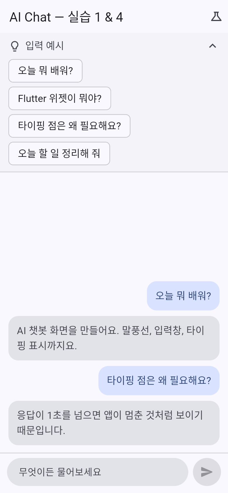
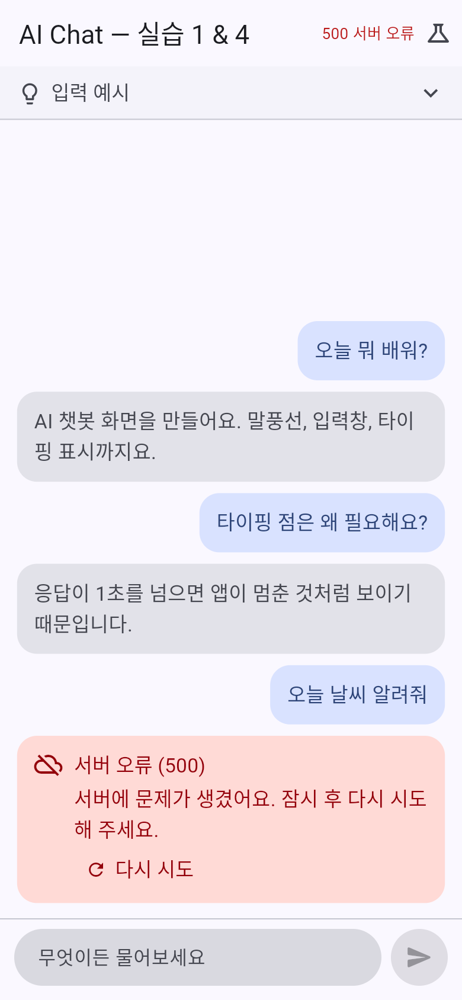
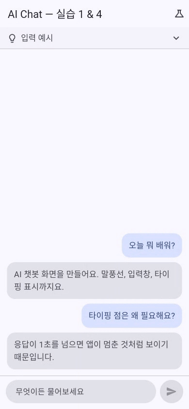
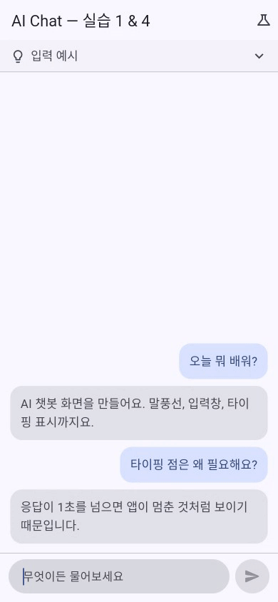

# 실습 1 — 채팅 UI (GAI3008-01 · 11주차)

> 목표: **보내고 받는 모양**을 먼저 만든다. API는 다음 실습에서 붙인다.
> 이 저장소는 **할 일 1번만 완성**되어 있고, 2~5번은 코드 안의 `TODO` 주석으로 안내한다.

## 실행

```bash
flutter pub get
flutter run -d chrome      # 또는 -d <에뮬레이터>
```

서버가 필요 없다. `_messages`에 들어 있는 가짜 대화와 가짜 API(`FakeChatApi`)로 화면만 만든다.

## 화면

| 기능 | 스크린샷 | 설명 |
|---|---|---|
| 기본 채팅 화면 |  | 사용자 말풍선은 오른쪽, AI 말풍선은 왼쪽. 최신 메시지가 아래에 쌓이고, 빈 입력창에는 "무엇이든 물어보세요" 힌트가 보인다 (실습 1 — 2·3·4) |
| 입력 예시 |  | 💡 입력 예시 줄을 누르면 예시 4개가 펼쳐진다. 예시를 누르면 입력창에 채워지고 패널은 다시 접힌다 (실습 1 — 4) |
| 오류 말풍선 |  | 500 오류가 나면 AI 쪽에 붉은 오류 말풍선과 **다시 시도** 버튼이 뜨고, 다음 전송 전까지 화면에 남는다. 앱바에는 재현 중인 오류 이름이 보인다 (실습 ④ — 1·2) |
| 오류 → 다시 시도 |  | 다시 시도를 누르면 사용자 말풍선을 늘리지 않고 마지막 문장을 다시 보낸다. 오류 → 타이핑 점 → 응답이 `AnimatedSwitcher`로 부드럽게 바뀌고, 오류 뒤에도 입력이 된다 (실습 ④ — 2·3·4) |
| 429 지수 백오프 |  | 429를 받으면 오류를 바로 띄우지 않고 "1초 뒤 다시 보내요 (1/2)"를 보여 준 뒤 자동으로 다시 보내 응답을 받는다 (실습 ④ — 5) |

### 애니메이션 — 상호작용 예시

| 상황 | 화면 | 설명 |
|---|---|---|
| 내가 입력할 때 |  | 입력창에 글자가 있으면 **오른쪽(사용자 쪽)** 맨 아래에 점 세 개 말풍선이 나타나고, 입력을 모두 지우면 사라진다. 전송 버튼도 이때만 켜진다 |
| AI가 답장할 때 |  | 전송하면 내 말풍선이 오른쪽에 붙고, **왼쪽(AI 쪽)** 에 점 세 개 말풍선이 1.2초 동안 보인 뒤 응답 말풍선으로 바뀐다. 기다리는 동안 전송은 막힌다 |

**어떻게 움직이나**

| 애니메이션 | 구현 | 동작 |
|---|---|---|
| 타이핑 점 | `_TypingDots` — `AnimationController`(1050ms, `repeat()`) + `AnimatedBuilder` | 점 3개가 1/3 주기씩 어긋나 차례로 위로 튀어 오르고(`easeOut` / `easeIn`), 올라갈수록 진해진다(투명도 0.3 → 1.0). 색은 사용자 쪽이면 `onPrimaryContainer`, AI 쪽이면 `onSurfaceVariant` |
| 상태 전환 | `_StatusBubble` — `AnimatedSwitcher`(250ms) + `FadeTransition` + `SizeTransition` | 목록 맨 아래 상태 자리가 비어 있음 ↔ AI 타이핑 점 ↔ 429 대기 안내 ↔ 오류 말풍선으로 바뀔 때, 이전 것은 줄어들며 흐려지고 새 것은 아래쪽에서 자라며 나타난다 |
| 입력 예시 패널 | `AnimatedSize`(200ms, `easeOut`) | 💡 입력 예시를 펼치고 접을 때 패널 높이가 부드럽게 늘고 준다 |

- 사용자 타이핑 점은 `_isUserTyping`(입력창이 비어 있지 않음)일 때만 목록 index 0에 끼워 넣는다. `reverse: true`라서 index 0이 화면 맨 아래다.
- AI 타이핑 점은 `ChatSending` 상태일 때 `AnimatedSwitcher`의 자식으로 들어간다. 그래서 응답이 오면 점이 사라지는 것과 동시에 응답 말풍선이 목록에 추가된다.
- `AnimationController`는 `dispose()`에서 정리한다. 점 말풍선에는 스크린 리더용 `Semantics` 라벨("메시지를 입력하고 있습니다" / "AI가 응답을 작성하고 있습니다")이 붙어 있다.

## 할 일

| # | 내용 | 상태 |
|---|---|---|
| 1 | `ListView.builder` + `reverse: true` — 최신이 아래 | ✅ **완성됨** |
| 2 | 말풍선 2종 — 사용자 오른쪽 / AI 왼쪽 | ✅ 완료 |
| 3 | 입력창 `TextField` + 전송 버튼 | ✅ 완료 |
| 4 | 빈 상태 — "무엇이든 물어보세요" | ✅ 완료 (입력창 힌트 + 입력 예시) |
| 5 | 키보드가 입력창을 가리지 않게 | ✅ 완료 |

`lib/main.dart`에서 `TODO 2`~`TODO 5`를 검색하면 해당 위치로 바로 간다.

## 구현 내용

| # | 구현 |
|---|---|
| 2 | `Align`으로 사용자 말풍선은 오른쪽, AI 말풍선은 왼쪽. 색은 `colorScheme`(`primaryContainer` / `surfaceContainerHighest`)에서 꺼내 다크 모드 대응. 최대 너비를 넘으면 줄바꿈 |
| 3 | `TextField` + `IconButton.filled` 전송 버튼. 엔터로도 전송, 빈 입력은 전송 버튼 비활성. `dispose()`에서 컨트롤러 정리 |
| 4 | 입력창이 비면 힌트로 "무엇이든 물어보세요"를 보여 준다. 배경에는 문구를 띄우지 않는다. 대화 영역 위쪽에 **펼치고 접는 입력 예시 패널**(처음엔 접힘)을 두고, 펼치면 예시 4개가 왼쪽에 세로로 쌓인다. 예시를 누르면 입력창에 채워지고(바로 전송되지 않음) 패널이 접힌다 |
| 5 | `Scaffold(resizeToAvoidBottomInset: true)` + `SafeArea`, Android는 `windowSoftInputMode="adjustResize"`. 화면이 낮을 때(가로 모드 + 키보드)는 입력창 최대 줄 수를 줄여 화면이 넘치지 않게 한다 |

**그 밖에 추가한 것**

- **타이핑 표시** — 입력 중에는 사용자 쪽, 응답 대기 중에는 AI 쪽에 점 세 개 애니메이션 말풍선
- **이전 대화 흔적** — 앱을 켜면 이미 몇 마디 나눈 것처럼 가짜 대화 4줄이 들어 있다
- **가짜 응답** — API 연결 전이라 전송 1.2초 뒤 "아직 미구현되었습니다."로 답한다 (실습 2에서 API로 교체)
- **대화 영역 확대** — 말풍선·입력 예시·타이핑 점을 `kChatScale`(1.2)배로 키웠다. 입력창과 전송 버튼은 원래 크기

## 완료 기준 (수업 중 통과)

- 말풍선이 **좌우로** 나뉜다
- 입력창이 화면 **아래**에 붙어 있다
- 목록이 비면 **빈 상태 문구**가 보인다
- 키보드가 올라와도 입력창이 **가려지지 않는다**

## 힌트

- `reverse: true`면 index 0이 **화면 맨 아래**다. 그래서 `_messages[length - 1 - i]`로 꺼낸다.
- 색은 `Theme.of(context).colorScheme`에서 꺼내면 다크 모드에서도 안전하다.
- `TextEditingController`는 `dispose()`에서 정리한다.
- `ListView`를 `Stack`으로 감싸면 빈 상태를 위에 겹칠 수 있다.

## 실습 ④ — 오류와 재시도 (1.11)

### 할 일

| # | 내용 | 상태 |
|---|---|---|
| 1 | 401·429·500·timeout을 한 상태로 | ✅ 완료 |
| 2 | 오류 말풍선 + 다시 시도 | ✅ 완료 |
| 3 | 재시도는 마지막 메시지를 다시 | ✅ 완료 |
| 4 | `AnimatedSwitcher`로 전환 | ✅ 완료 |
| 5 | 429면 지수 백오프 1s → 2s | ✅ 완료 |

### 구현 내용

| # | 구현 |
|---|---|
| 1 | 어떤 예외든 `ChatError.from()`으로 오류 하나(`unauthorized`·`rateLimited`·`server`·`timeout`·`unknown`)로 바꾼다. 화면 상태는 `ChatIdle` / `ChatSending` / `ChatBackoff` / `ChatFailed` 중 하나(`sealed class ChatStatus`)라 "대기 중이면서 오류" 같은 모순이 생기지 않는다. 5초 안에 응답이 없으면 timeout |
| 2 | AI 쪽(왼쪽)에 `errorContainer` 색 오류 말풍선 — 종류별 아이콘·제목·설명과 **다시 시도** 버튼. 다음 전송이나 재시도 전까지 화면에 남는다 |
| 3 | 마지막으로 보낸 문장을 기억해 두었다가 그대로 다시 보낸다. 사용자 말풍선은 새로 추가하지 않는다 |
| 4 | 목록 맨 아래 상태 자리를 `AnimatedSwitcher`(페이드 + 크기, 250ms)로 감싸 타이핑 점 ↔ 대기 안내 ↔ 오류 말풍선이 부드럽게 바뀐다 |
| 5 | 429면 오류를 바로 띄우지 않고 1초, 2초 기다렸다가 자동으로 다시 보낸다. 기다리는 동안 "N초 뒤 다시 보내요 (k/2)"를 보여 주고, 다 써도 429면 오류 말풍선 |

### 오류 재현하기

API가 아직 없어서 가짜 API가 오류를 흉내 낸다. 앱바 오른쪽 🧪 **오류 재현** 메뉴에서 다음 요청의 결과를 고른다.

| 메뉴 | 결과 |
|---|---|
| 정상 응답 | 1.2초 뒤 "아직 미구현되었습니다." |
| 401 인증 오류 | 1.2초 뒤 인증 오류 말풍선 |
| 429 요청 과다 | 1초 → 2초 자동 재시도 뒤 429 오류 말풍선 |
| 429 한 번 후 성공 | 한 번 막힌 뒤 1초 기다렸다가 응답 |
| 500 서버 오류 | 1.2초 뒤 서버 오류 말풍선 |
| timeout 응답 없음 | 5초 뒤 응답 시간 초과 말풍선 |

정상이 아닌 모드를 고르면 앱바에 지금 재현 중인 오류 이름이 보인다. **다시 시도** 전에 메뉴를 "정상 응답"으로 바꾸면 재시도가 성공하는 모습을 볼 수 있다.

### 완료 기준

- 화면에 오류가 **남는다**
- **다시 시도**가 동작한다
- 오류 뒤에도 **입력이 된다**

## 구조

```
lib/main.dart               ← 화면 (실습 1 TODO 2~5, 실습 ④ 오류 말풍선·재시도·백오프)
lib/chat_api.dart           ← ChatApi · ChatError · ChatStatus · 가짜 API(FakeChatApi)
test/widget_test.dart       ← 앱 실행·전송·키보드·입력 예시 동작 테스트
test/error_retry_test.dart  ← 실습 ④ 할 일 1~5와 완료 기준 테스트
test/layout_test.dart       ← 화면 크기·키보드·글자 크기 조합에서 레이아웃이 넘치지 않는지 확인
docs/SCREENSHOT_GUIDE.md    ← README에 넣을 스크린샷·GIF 촬영 지침
docs/screenshots/           ← README 화면 섹션의 스크린샷 3장 · GIF 4개
```

## 테스트

```bash
flutter analyze
flutter test           # 65개
```

## 제출

- 이 저장소를 `fork` → 브랜치 `feat/내이름-chat`
- 커밋 2개 이상, PR 1개
- PR 본문 3줄: 무엇 · 왜 · 시험

---

ⓒ 2026 Baryon Labs · 연세대학교 GAI3008-01 응용모바일프로그래밍 교육자료
