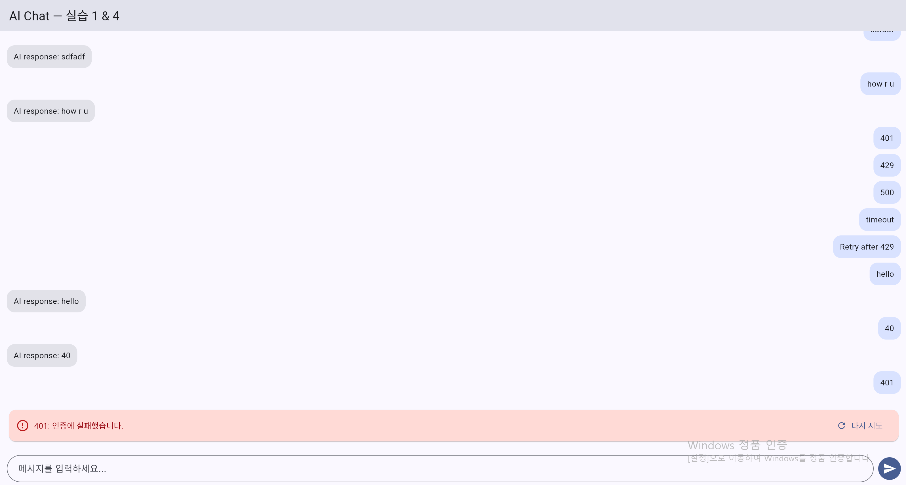

## 11주차 과제 — 채팅 UI 및 오류·재시도

**이름:** 나선우  
**학번:** 2020106138

### 실습 1 — 채팅 UI

- 사용자와 AI 메시지를 구분하는 말풍선 구현
- 메시지 입력창과 전송 버튼 구현
- 메시지 전송 및 입력창 초기화
- 빈 채팅 화면 안내 문구 구현

### 실습 4 — 오류와 재시도

- 401, 429, 500, timeout 오류 시뮬레이션
- 오류 메시지와 다시 시도 버튼 구현
- 마지막 실패 메시지 재시도 기능 구현
- AnimatedSwitcher를 이용한 화면 전환
- 429 오류 발생 시 지수 백오프 적용 (1초 → 2초 → 4초)
- 오류 발생 후에도 새 메시지 입력 가능

### 실행 방법

```bash
flutter pub get
flutter run -d chrome
```

### 실행 화면


